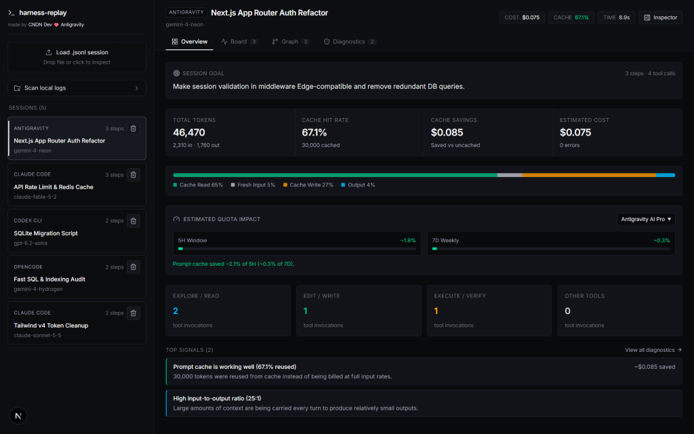
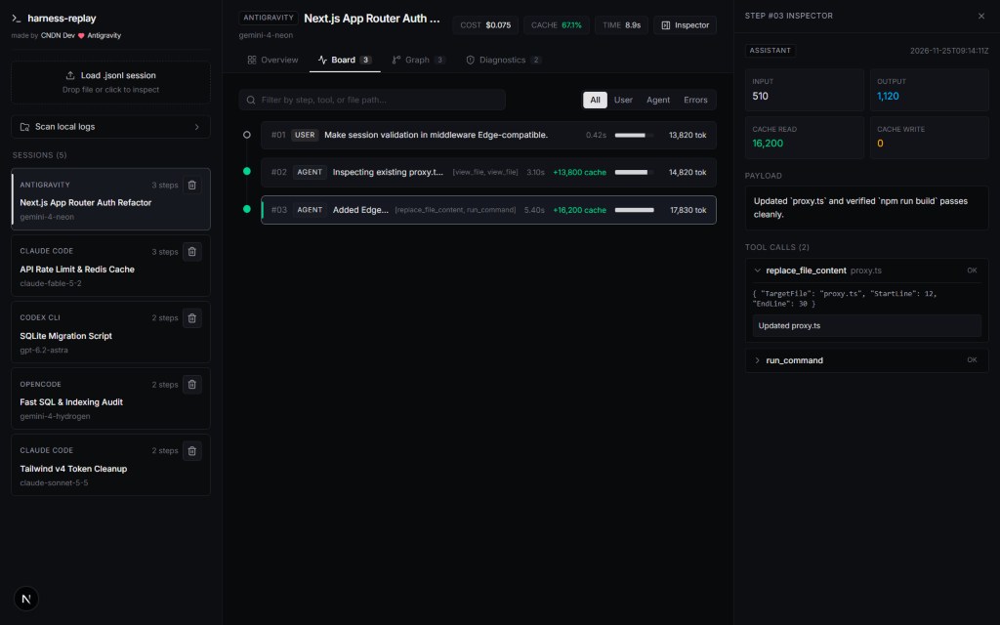
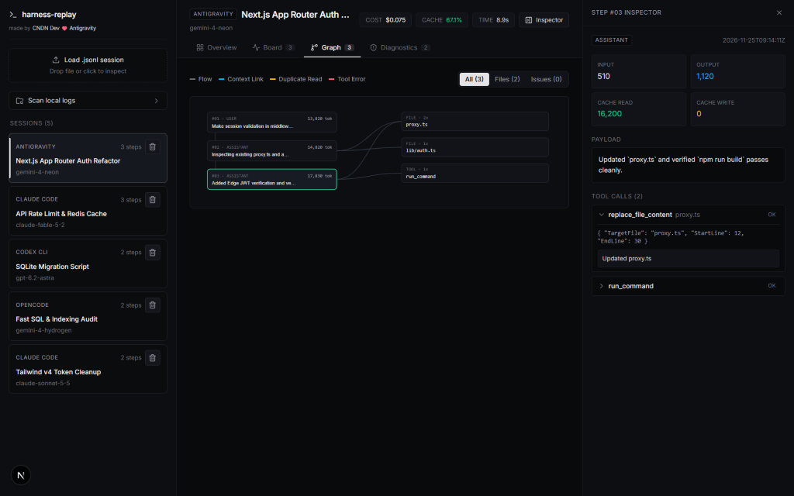

# harness-replay

**Zero-telemetry, local-first session replay and token/cache optimization viewer for AI coding harnesses.**

Inspect what your coding agents (**Claude Code**, **Codex CLI**, **OpenCode**, **Antigravity**) actually did step by step—without sending a single byte of your logs, prompts, or file paths to any external server.

---

## Screenshots

### Overview & Quota Impact


### Step Board & Inspector


### Context Graph


---

## Why `harness-replay`?

Modern AI coding harnesses execute dozens of tool calls, read files repeatedly, and rely heavily on prompt caching to keep costs and rate-limit usage down. Terminal scrollback makes it hard to answer simple questions:

- **How effective is prompt caching?** How many tokens, dollars, and 5-hour/7-day quota % did `cache_read` actually save in this session?
- **Where are tokens being wasted?** Did the agent read the same large file multiple times, loop on a failing tool, or carry bloated context?
- **What happened at step 14?** Which tool call failed, which files were touched, and how much did that turn cost?

`harness-replay` parses `.jsonl` session transcripts locally and gives you a fast, inspectable **Swarm Mission Control** UI.

## Features

- **100% Local & Zero Telemetry:** No analytics, no outbound requests, no auth-file fingerprinting. Drop a `.jsonl` file in the browser, use the opt-in Local Session Scanner, or explore built-in demo sessions.
- **Multi-Harness Normalization:** Built-in parsers for **Claude Code**, **Codex CLI**, **OpenCode**, and **Antigravity** (plus generic JSONL session logs).
- **Opt-In Local Session Scanner:** Scans preset local log directories (`~/.claude/projects`, `~/.codex/sessions`, `~/.local/share/opencode`, `~/.gemini/antigravity/brain`) or user-approved paths with path-traversal protection (`isPathInsideRoots`).
- **Cache Hit & Quota Impact Estimator:** Breaks down `input`, `output`, `cache_read`, and `cache_write` tokens, estimates dollar savings, and models **5H / 7D subscription quota impact** across plan presets (Claude Pro/Max/Ultra, ChatGPT Plus/Pro, Antigravity AI Pro/Ultra, API budgets; rough estimates based on API token pricing).
- **8-Rule Offline Waste Detector:** Automatically flags low cache reuse, oversized token spikes, context bloat, duplicate file reads, repeated tool-call loops, high input-to-output ratios, premium model mismatches, and failed tool calls.
- **Mission Control Views:**
  - **Overview:** Session goal, token breakdown bar, quota impact card, tool category counts, and top optimization signals.
  - **Board:** Filterable step-by-step timeline (`All`, `User`, `Agent`, `Errors`) paired with a collapsible **Step Inspector** for prompts, expandable tool-call arguments/outputs, and distinct `NO RESULT` ("Result not recorded") badges for truncated logs.
  - **Graph:** Interactive step-to-file/tool **Context Graph** highlighting flow, context links, duplicate reads, and tool errors.
  - **Diagnostics:** Full optimization report with one-click jumps to affected steps.
- **Browser Persistence:** Uploaded sessions, dismissed demos, and plan selections persist locally in `localStorage`.

## Getting Started

### Prerequisites

- **Node.js** 20+
- **npm** 10+

### Local Setup

```bash
git clone https://github.com/yamisagi/harness-replay.git
cd harness-replay
npm install
npm run dev
```

Open [http://localhost:3000](http://localhost:3000) in your browser.

### Production Build

```bash
npm run lint
npm run build
npm run start
```

## Tech Stack

- **Framework:** Next.js 16 (App Router) + React 19 + TypeScript (`strict: true`)
- **Styling:** Tailwind CSS 4 + `lucide-react` + `motion/react`

## Project Structure

```text
app/                      # Next.js App Router (layout, page, globals.css, local API routes)
src/
├── types/                # NormalizedSession, SessionStep, ToolCall, and analytics contracts
├── data/                 # Built-in demo sessions for instant exploration
├── lib/
│   ├── parsers/          # Modular .jsonl parsers (Claude Code, Codex CLI, OpenCode, Antigravity)
│   ├── server/           # Opt-in local filesystem session scanner
│   ├── analytics/        # Token/cost calculator, 8-rule waste detector, context graph builder
│   ├── storage/          # Browser localStorage persistence with quota handling
│   ├── pricing.ts        # Model token pricing table
│   └── quota.ts          # 5H / 7D quota impact estimator
├── hooks/                # Client state hooks (useReplayWorkspace, useLocalSessions)
└── components/           # Swarm Mission Control UI & *Styles.ts dictionaries
```

## Contributing

Contributions are welcome! Please read [CONTRIBUTING.md](CONTRIBUTING.md) before opening an issue or pull request—especially if you want to add a parser for another AI coding harness (Cursor, Windsurf, Kiro, Cline, Pi, etc.).

## License

[MIT](LICENSE)
